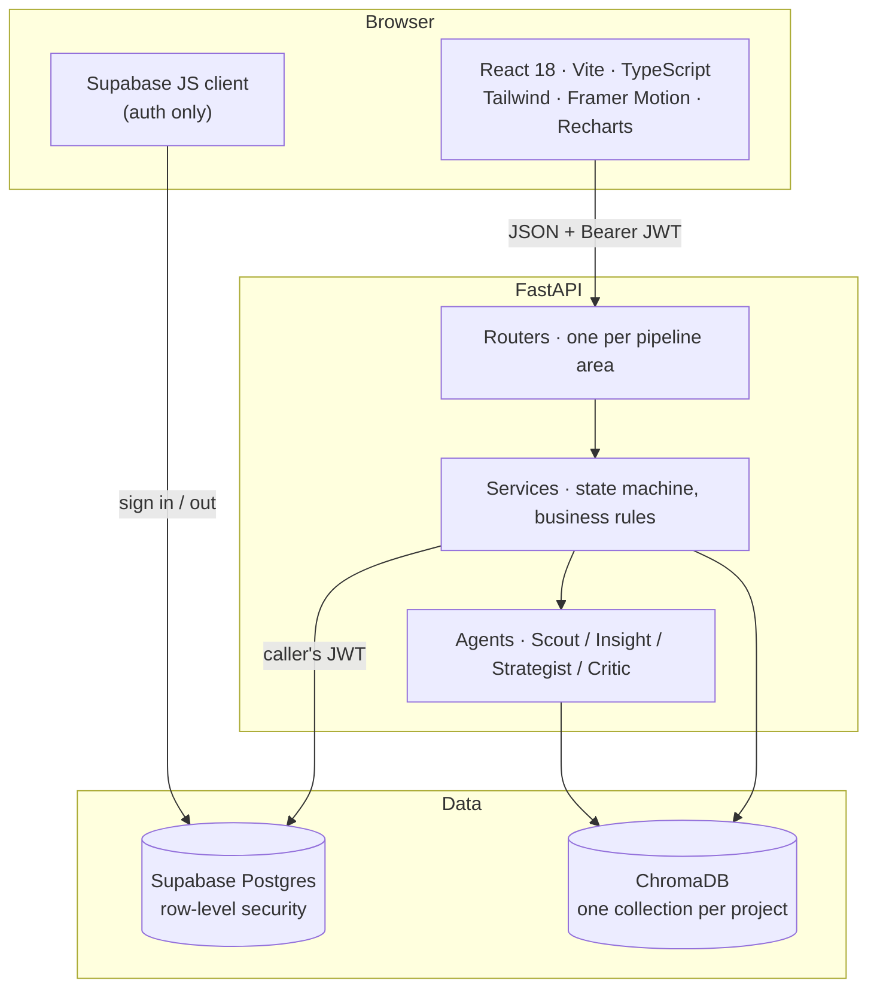
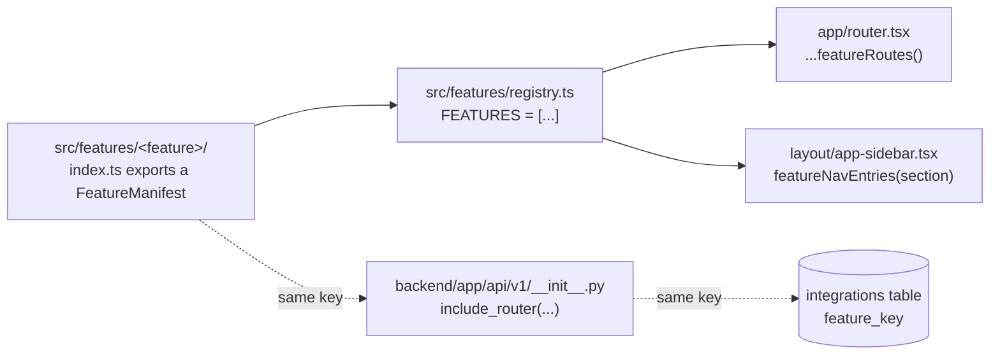

# Architecture

Last updated: 2026-09-06

---

## 1. The shape of the system

Three layers, one direction of dependency.



**Auth never touches the backend.** The browser talks to Supabase Auth directly,
so no password ever reaches our code. What the browser sends us is a JWT, which
we verify and then *forward* to Postgres so row-level security decides what the
query can see. See [security.md](security.md).

---

## 2. The nine stages, as implemented

The deck's diagram is the product's core user journey, so it is also the shape
of the code: routes, services and agents all line up against it.

```mermaid
flowchart LR
    S1["1 · Input<br/><i>you</i>"] --> S2["2 · Scout<br/><i>agent</i>"]
    S2 --> S3["3 · Preprocess<br/><i>system</i>"]
    S3 --> S4["4 · Insight<br/><i>agent</i>"]
    S4 --> S5{{"5 · Gap Refinement<br/><b>HUMAN GATE</b>"}}
    S5 --> S6["6 · Strategist + Critic<br/><i>agents</i>"]
    S6 --> S7{{"7 · Final Approval<br/><b>HUMAN GATE</b>"}}
    S7 -->|approve| S8["8 · Document<br/><i>system</i>"]
    S7 -->|revise| S6
    S8 --> S9["9 · Automation<br/><i>agent</i>"]

    style S5 fill:#F6DFA6,stroke:#C9822B,color:#171717
    style S7 fill:#F6DFA6,stroke:#C9822B,color:#171717
```



### The gates are enforced in the runner, not the UI

`backend/app/services/pipeline_service.py::run_from` walks stages in order and
**returns** when it reaches 5 or 7:

```python
while stage_id <= 9:
    if stage_id in CHECKPOINT_STAGES:
        _park_at_checkpoint(state, stage_id)
        ...
        return          # nothing advances until a human posts a decision
```

Two further guards sit in front of the gates:

- `gap_service.submit_review` **refuses** while any gap is still `pending`.
  Letting an untriaged finding through to the Strategist is exactly what the
  checkpoint exists to stop.
- `strategy_service.submit_review` **refuses** a rejection with no notes. A
  revision request with no explanation gives the agents nothing to work with.

Both are covered by `backend/tests/test_hitl_checkpoints.py`.

### Route ↔ stage mapping

| Stage | Endpoint | Frontend route |
|---|---|---|
| 1 | `POST /api/v1/projects` | `/app/projects/new` |
| 2 | `POST /api/v1/projects/{id}/scout/run` · `GET .../scout/status` | `/app/projects/:id/pipeline` |
| 3 | internal: chained by the runner | (shown in the stepper) |
| 4 | `GET /api/v1/projects/{id}/gaps` | `/app/projects/:id/insights` |
| 5 | `PATCH .../gaps/{gap_id}` · `POST .../gaps/review` | `/app/projects/:id/review-gaps` |
| 6 | `GET .../strategy` · `POST .../strategy/generate` | `/app/projects/:id/strategy` |
| 7 | `POST .../strategy/approve` · `POST .../strategy/revise` | `/app/projects/:id/review-strategy` |
| 8 | `GET .../document` · `GET .../document/export` | `/app/projects/:id/document` |
| 9 | `GET .../automation` · `POST .../automation/suggest` | `/app/projects/:id/automation` |
|, | `GET .../pipeline` · `POST .../pipeline/reset` · `GET .../cost` | `/app/projects/:id/pipeline` |

---

## 3. The agent layer

Every agent implements one interface, in `backend/app/api/v1/agents/base.py`:

```python
class BaseAgent(abc.ABC):
    name: str
    stage: int
    is_live: bool

    @abc.abstractmethod
    async def run(self, context: dict[str, Any]) -> AgentResult: ...
```

`AgentResult` carries the payload plus `items_processed`, `duration_ms`,
`tokens_used` and `cost_usd`. The runner persists the payload; **an agent never
writes to the database itself.** That constraint is what makes a mock and a
live agent genuinely interchangeable: neither knows how storage works.

### What ships today

| Stage | Class | Status | What a live version would do |
|---|---|---|---|
| 2 | `MockScoutAgent` | mock | Fetch landing pages, social posts, reviews, forums, news |
| 3 | `MockPreprocessAgent` | **partly real** | Chunking is genuine and writes to Chroma; embeddings use Chroma's default model rather than OpenAI |
| 4 | `MockInsightAgent` | mock | Retrieve per dimension, compare, require a quote per claim, reject claims whose quote cannot be matched back |
| 6a | `MockStrategistAgent` | mock | Prompt with accepted gaps, evidence, intake and reviewer notes |
| 6b | `MockCriticAgent` | **rule-based, real logic** | A second model attacking the draft on four dimensions |

Swapping one in is a single line in `agents/registry.py`:

```python
_MOCK_AGENTS: dict[int, type[BaseAgent]] = {
    2: MockScoutAgent,      # -> LangChainScoutAgent
    ...
}
```

### The Critic is the load-bearing one

"Reduces hallucinated and misleading insights" is the project's central claim,
and the Critic is the only thing backing it. So the mock is written to behave
like the real thing **in the way that matters**: every intervention produces a
`CriticFeedback` record that keeps *both* the original text and the replacement.

```python
{
  "verdict": "challenged",        # strengthened | challenged | rejected | approved
  "dimension": "feasibility",     # strength | clarity | feasibility | evidence
  "before": "Publish three guides per week.",
  "after":  "Publish one guide per week.",
  "severity": "major",
}
```

The UI renders those side by side (`CriticPanel`). **A live Critic must preserve
this contract**: a critique nobody can inspect is worth nothing, and the claim
becomes unverifiable. `backend/tests/test_critic_agent.py` asserts it.

The mock applies four checks: reject paid work with no declared budget, trim a
plan past a sustainable action count, hedge outcome claims with no source, and
add a measurement step where none exists.

---

## 4. The evidence trail

The difference between this and a generic suggestion engine is that every claim
carries its source. That is a structural commitment, not a UI feature:

```
ScrapedSource ──chunked──▶ Chroma ──retrieved──▶ Evidence ──attached to──▶ Gap
                                                    │
                                                    └─▶ {source_id, source_url,
                                                         source_title, quote,
                                                         relevance}
```

- `Gap.evidence` is non-empty for every gap the system produces.
- `EvidenceList` renders "No supporting source was attached to this claim"
  rather than nothing, so an uncited claim cannot pass as cited.
- `Gap.confidence` is shown as a **segmented** meter, not a smooth gradient, discrete segments discourage over-reading small differences.
- The human's `user_priority` sits *alongside* the agent's `priority` rather
  than overwriting it, so the disagreement stays visible.

---

## 5. Frontend structure

```
src/
├── app/            router.tsx, route-guards.tsx
├── pages/
│   ├── marketing/  landing, how-it-works, features, about, pricing, contact
│   ├── auth/       login, signup, forgot-password, reset-password
│   └── app/        dashboard, projects, and one page per pipeline stage
├── components/
│   ├── ui/         themed primitives (button, dialog, select, …)
│   ├── layout/     shells, sidebar, both marketing nav variants
│   ├── pipeline/   the animated stepper, the signature interaction
│   ├── charts/     Recharts wrappers over a validated palette
│   ├── marketing/  section, comparison table, pipeline teaser
│   └── shared/     gap card, critic panel, evidence list, state views
├── features/       ← integration slot (section 7)
├── lib/            api client, supabase, query client, mock data, motion
├── hooks/  stores/  styles/  types/
```

### State: three kinds, three tools

| Kind | Tool | Why |
|---|---|---|
| Server state | **TanStack Query** | Caching, polling, invalidation, optimistic updates |
| Client/UI state | **Zustand** | Selector-based subscriptions, so a pipeline tick re-renders one card rather than the tree |
| Form state | **react-hook-form + zod** | Uncontrolled inputs, one schema shared with the backend's rules |

Zustand was chosen over Context specifically because of the stepper: stage
status updates several times a second while a run is live, and a Context value
change re-renders every consumer.

### Polling, and why it stops

`usePipeline` polls only while something is actually running:

```ts
refetchInterval: (query) => {
  const running = Object.values(data.stages).some((s) => s.status === 'running')
  return running ? config.pipelinePollMs : false
}
```

Once the run parks at a checkpoint there is nothing to poll for. The next
change comes from a human. Supabase Realtime is the natural upgrade; see
section 9.

### Demo mode

`lib/config.ts` exposes one switch:

```ts
export const isDemoMode = config.demoMode || !hasSupabase
```

Every function in `lib/api/services.ts` branches on it with an identical
signature either way, so nothing downstream can tell the difference. The mock
backend (`lib/mock/mock-api.ts`) runs a real timer-driven state machine, it
parks at stages 5 and 7 exactly as the server does, so the stepper animates
against genuine transitions rather than a canned sequence.

Anything rendered from seeded data is badged `DemoBadge`, so a defence audience
is never left guessing whether the output is live.

---

## 6. Design system

Five brand tokens, defined once in `src/styles/theme.css` as HSL channel
triplets so Tailwind can apply opacity modifiers:

| Token | Hex | Role |
|---|---|---|
| `butter-cream` | `#F6DFA6` | Secondary accent; **the human-checkpoint colour** |
| `soft-vanilla` | `#FFF4D8` | Light canvas |
| `ink-black` | `#171717` | Dark canvas, primary text on light |
| `warm-gray` | `#A89F94` | Muted text, borders, dividers |
| `burnt-honey` | `#C9822B` | Primary CTA, active nav, focus rings |

No component contains a hex value. Light and dark are the same five tokens with
their roles swapped, which is why the theme toggle was cheap to build now and
would have been expensive to retrofit.

**Stage colours.** The deck codes the nine stages cyan → indigo → teal → purple
→ orange → violet → orange → blue → green. Those hues are preserved so the
diagram stays recognisable, but every one is pulled below 65% saturation and
warmed to sit inside the editorial palette. Stages 5 and 7 deliberately take
burnt-honey and butter-cream: **the brand accents mark the human moments.**

**Glass** is scoped, not ambient, pipeline stage cards, HITL panels, floating
nav, metric tiles. Never on long-form content; readability wins.

**Chart colour is separate** and was validated rather than chosen. Recharts
writes SVG presentation attributes, which do not resolve `var()`, so
`components/charts/chart-theme.ts` holds concrete hex values. Each mode's
palette passes all six checks (lightness band, chroma floor, CVD separation
under protanopia and deuteranopia, normal-vision floor, contrast) against its
own surface: dark is not a flipped light. Four categorical slots is the
ceiling; a fifth series folds into "Other".

---

## 7. Feature integration layer

Teammates' features live in separate repos and land here over time. The seam is
designed so that adding one **touches two files and no existing code.**



The manifest is the whole contract:

```ts
interface FeatureManifest {
  key: string           // stable; joins frontend, backend and the DB row
  name: string
  description: string
  owner: string         // so it is obvious who to ask when it breaks
  routes: { path: string; component: ComponentType }[]
  nav: { label: string; icon: LucideIcon; to: string
         section: 'main' | 'project' | 'settings' }[]
  enabled: boolean      // false = registered but not mounted
}
```

`router.tsx` spreads `featureRoutes()` into the authenticated shell's children;
`app-sidebar.tsx` renders `featureNavEntries(section)` in each section. Neither
knows what a feature is.

`enabled: false` lets a half-finished module sit in the tree without affecting
anyone: routes are not mounted, nav entries are not shown.

Step-by-step instructions: [`frontend/src/features/README.md`](../frontend/src/features/README.md).

**Nothing is registered yet.** No external feature was integrated in this build.

---

## 8. Backend structure

```
app/
├── main.py              app assembly, CORS, health
├── core/
│   ├── config.py        settings, `is_demo` derivation
│   ├── security.py      JWT verification → CurrentUser
│   ├── supabase.py      user client (RLS) vs service client (bypasses RLS)
│   ├── errors.py        the single error envelope
│   └── logging.py       request-id middleware
├── api/v1/
│   ├── __init__.py      router aggregation ← features mount here
│   ├── auth/  users/  projects/  pipeline/  documents/
│   └── agents/          base, registry, scout, preprocess, insight,
│                        strategist, critic
├── models/              Pydantic v2, camelCase on the wire
├── services/            repository, pipeline_service, gap_service,
│                        strategy_service, document_service,
│                        automation_service, demo_data
├── db/schema.sql        tables, indexes, RLS policies
└── vectorstore/chroma.py
```

### Storage

Two interchangeable backends behind one interface (`services/repository.py`):

- **`MemoryRepository`**: process-local dicts, seeded with the demo project.
  Demo mode and the whole test suite run on it, which is why the tests need no
  database, no network and no keys.
- **`SupabaseRepository`**: Postgres via the Supabase client, every call
  carrying the caller's JWT.

Rows are stored snake_case, matching the Postgres columns; the Pydantic models
serialise to camelCase at the edge via `alias_generator=to_camel`.

### Background work

`FastAPI BackgroundTasks` starts a run after the response has been sent. The
task calls `asyncio.run(...)` because BackgroundTasks executes sync callables in
a worker thread with no loop of its own, and it catches everything. A crashed
background task must not be silent.

This is adequate for a single process. **Upgrade path:** Celery + Redis, or
Supabase Edge Functions, once a run can outlive a web worker. The seam is
`pipeline_service.run_from(project_id, user_id, start_stage)`, a pure function
of those three arguments, so it moves to a queue without changes.

---

## 9. Known architectural limits

| Limit | Consequence | Path forward |
|---|---|---|
| Agents are mocks | Output is realistic but hand-written | Implement `BaseAgent`, swap in `registry.py` |
| BackgroundTasks | A run dies with the worker process | Celery/Redis or Edge Functions |
| Polling, not push | Up to `VITE_PIPELINE_POLL_MS` of latency | Supabase Realtime on `pipeline_states` |
| Pipeline state as one JSON blob | Concurrent writers would clobber each other | Fine while one runner owns a project; needs row-level stage records otherwise |
| Chroma is local and on disk | Does not survive a stateless redeploy | Chroma server mode, or a hosted vector DB |
| Single reviewer per checkpoint | No multi-user review | `hitl_reviews` already models multiple rows per stage |

---

## 10. Deviations from the original spec

Flagged rather than silently absorbed:

1. **`api/v1/agents/` holds service modules, not routes.** The spec listed it
   beside the routers. Agents are invoked by the pipeline service, not by HTTP,
   so giving them a router would have created an endpoint that should not
   exist. They live there as a package with no `routes.py`.

2. **`GET /projects/{id}/reviews` and `GET /projects/{id}/cost` were added.**
   Not in the spec's endpoint list, but the HITL audit trail and the run-cost
   readout both need them and both are user-visible features.

3. **`pipeline_states` is an extra table.** The spec's schema draft did not
   include one; the nine-stage state has to persist somewhere across a
   background run.

4. **`content_suggestions` is an extra table.** Stage 9 was built as a working
   feature, which needs storage.
