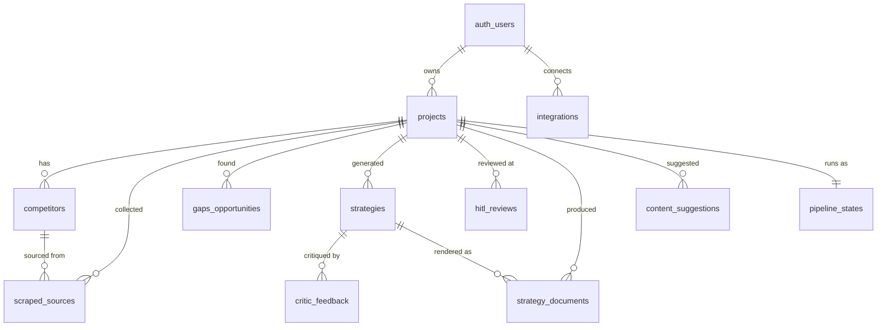

# Database

Last updated: 2026-09-06

Two stores. Postgres holds everything structured; ChromaDB holds the vectors.

---

## 1. Postgres (Supabase)

Schema source of truth: [`backend/app/db/schema.sql`](../backend/app/db/schema.sql).
It is idempotent (every `create` is `if not exists`, every policy is dropped
before being recreated), so re-running it after an edit is safe.



### Tables

| Table | Holds | Notes |
|---|---|---|
| `projects` | One brand analysis run | Root of every ownership check |
| `competitors` | Who to analyse | `social_handles` is JSONB |
| `scraped_sources` | Stage 2/3 output | `excerpt` for lists; full text lives in Chroma |
| `ecommerce_products` | Stage 2 output for e-commerce comparisons | One scraped listing; common fields are columns, the rest is JSONB |
| `ecommerce_product_images` | Stage 2 output for e-commerce comparisons | One product photo per row, in gallery order (position 1 is the main image). Stores the marketplace's own image URL; nothing is downloaded. Cascades from its listing |
| `ecommerce_product_price_tiers` | Stage 2 output, Alibaba listings | One quantity price break per row ("100-499 pieces: US$0.77"), lowest quantity first; `max_quantity` null for the open-ended top tier. Cascades from its listing |
| `ecommerce_product_suppliers` | Stage 2 output, Alibaba listings | The selling supplier's public trust credentials, one per listing: years on Alibaba, Gold / Verified / Trade Assurance, response rate, order history. No contact details. Cascades from its listing |
| `website_pages` | Stage 2 output for website comparisons | One crawled page: title, meta description, headings and links (JSONB), readable text, renderer, and how many clicks from the submitted link. `signals` (JSONB) holds the checkable facts the A-F parameters are scored from. Cascades from its project |
| `website_page_images` | Stage 2 output for website comparisons | One picture kept from a crawled page, most representative first (`og_image`, then `hero`, then `content`). The site's own URL; nothing is downloaded. Icons, logos, sprites and tracking pixels never reach it. Cascades from its page |
| `instagram_posts` | Stage 2 output for social comparisons | One public post: caption, hashtags, likes, comment count, media and engagement total. Unique on `(project_id, role, post_url)`: a collaboration post appears on both collaborators' profiles, so it can belong to both sides. `profile_username` is the scraped profile's own handle and is what the screen labels a side with; `owner_username` is the post's author, which differs on exactly those collaboration posts. Cascades from its project |
| `instagram_post_media` | Stage 2 output for social comparisons | A post's images and videos, carousels in slide order. Instagram's own CDN URLs; nothing is downloaded. Cascades from its post |
| `instagram_post_comments` | Stage 2 output for social comparisons | The public comments collected for a post. Cascades from its post |
| `gaps_opportunities` | Stage 4 output + stage 5 decisions | `evidence` JSONB, never empty |
| `strategies` | Stage 6 output | `initiatives` and `critic_feedback` JSONB; versioned |
| `critic_feedback` | Critic interventions, relational copy | Queryable across projects for the report's evaluation chapter |
| `hitl_reviews` | **The audit trail** | One row per human decision, stage 5 or 7 |
| `strategy_documents` | Stage 8 output | `sections` JSONB + rendered `content` |
| `content_suggestions` | Stage 9 output | Mapped to an initiative |
| `pipeline_states` | Nine-stage run state | One JSONB doc per project |
| `integrations` | Teammates' feature modules | `feature_key` joins to the frontend registry |
| `contact_submissions` | Public contact form | Write-only under RLS |

### Why `ecommerce_products` is not `daraz_products`

The columns on it -- price, rating, review count, brand, seller, stock, images
-- are the ones every marketplace has. A platform is told apart by the
`platform` column (`'daraz'` or `'alibaba'`), so a new marketplace reuses the
table rather than bringing its own. Anything that genuinely is platform-specific
lives in `raw_metadata`, which is also what the comparison engine reads, so a
scraper can return fields nobody has modelled yet without a migration.

Alibaba is a wholesale marketplace, so migration 0004 added what B2B listings
share: nullable `max_price`, `moq`, `moq_unit` and `lead_time_days` columns
(null on Daraz rows), `price` / `original_price` widened to `numeric(14,4)` for
sub-cent unit prices, and the two linked tables above for data with its own
shape (a ladder of tiers, a supplier profile).

Two columns exist that look redundant and are not:

- `text_fields` keeps the chunkable content (title, description, specs,
  reviews, ...) on the row as well as in Chroma. Re-embedding is then a local
  operation rather than a re-scrape, which matters because scraping is slow,
  rate-limited and may fail.
- `source_id` points back at the `scraped_sources` row the listing produced, so
  a gap's evidence cites something the sources screen already shows.

A partial unique index enforces one `role = 'own'` listing per project: that row
is the baseline every comparison is measured against, and two of them would make
the result ambiguous.

### Why pages and posts are stored twice

A crawled page and an Instagram post each produce **two** rows: a generic
`scraped_sources` row, and a detail row in `website_pages` or `instagram_posts`.
That is the same split e-commerce uses, for the same reason.

`scraped_sources` is what the sources screen lists and what a gap's evidence
cites, so every kind of collected material has to appear there in one shape. It
cannot hold a page's headings and links or a post's hashtags, likes and
comments, and widening it until it could would give it a column per platform.
The detail tables hold that structure; `scraped_sources.kind` already
distinguished `landing_page` from `social_post`, so it needed no change at all.

`text_fields` on each detail row is the chunkable content (a page's body,
headings and metadata; a post's caption, hashtags and comments), kept on the row
as well as in Chroma so a re-embed never needs a re-crawl. There is no vector
column here: embeddings live in the project's Chroma collection, the same as
every other source.

### Design decisions worth stating

**Why `pipeline_states` is one JSONB document.** The nine-stage state is always
read and written as a unit, and its shape has to stay in lockstep with the
frontend's `PipelineState` type. Splitting it into nine rows would buy nothing
and would let the halves drift. The cost is that concurrent writers would
clobber each other: acceptable while exactly one runner owns a project at a
time, and called out in [architecture.md](architecture.md#9-known-architectural-limits).

**Why `critic_feedback` exists twice.** It is stored inline on `strategies` as
JSONB (how the UI reads it. One fetch, no join) *and* as its own table (so
critic activity can be aggregated across projects for the evaluation chapter).
The inline copy is authoritative for rendering.

**Why `user_priority` is a separate column.** The reviewer's override sits
alongside the agent's `priority` rather than replacing it. The disagreement
between model and human is exactly the thing this project is about measuring,
so it is not thrown away.

**Why `evidence` is JSONB and not a table.** Evidence is only ever read with its
gap, never queried independently. A join table would add cost with no benefit.

**Ids are `text`, not `uuid`.** Application-generated (`proj_a1b2c3d4e5f6`) so
the same value works identically in the in-memory store, the tests and Postgres,
and so an id is readable in a log line. `owner_id` and `reviewer_id` are real
`uuid` values referencing `auth.users`.

### Constraints that encode product rules

```sql
current_stage smallint not null default 1 check (current_stage between 1 and 9)
confidence    numeric(4,3) not null check (confidence between 0 and 1)
stage         smallint not null check (stage in (5, 7))   -- hitl_reviews
```

The `hitl_reviews.stage` check is the database refusing to record a "human
review" of a stage that has no human in it.

---

## 2. Row-level security

**RLS is the only enforcement point.** Application code adds no ownership
filter anywhere: it cannot be talked out of one by a forgotten `WHERE`.

Every policy resolves ownership back to `projects.owner_id = auth.uid()`:

```sql
create policy gaps_owner_all on public.gaps_opportunities
    for all using (exists (
        select 1 from public.projects p
        where p.id = gaps_opportunities.project_id and p.owner_id = auth.uid()))
    with check (exists (
        select 1 from public.projects p
        where p.id = gaps_opportunities.project_id and p.owner_id = auth.uid()));
```

Written out per table rather than through a helper function, so each policy is
readable on its own in the Supabase dashboard.

| Table | Policy |
|---|---|
| `projects` | `owner_id = auth.uid()` |
| `competitors`, `scraped_sources`, `gaps_opportunities`, `strategies`, `hitl_reviews`, `strategy_documents`, `content_suggestions`, `pipeline_states` | ownership via parent project |
| `critic_feedback` | ownership via `strategies` → `projects` |
| `integrations` | `owner_id = auth.uid()` |
| `contact_submissions` | **insert only, by anyone; no read policy** |

`contact_submissions` deliberately has no read policy. Without an admin UI, a
read policy would be a way for any authenticated user to harvest submitted email
addresses. Reads go through the service role.

### The one place RLS is bypassed

`core/supabase.py` exposes two clients:

- `get_user_client(token)`. Carries the caller's JWT. **Every request path.**
- `get_service_client()`, service role, **bypasses RLS.** Used only by the
  background pipeline worker, which runs after the originating request has
  returned and no longer has a JWT.

`repository.get_worker_repository()` is the only caller, and its docstring says
so. It must never be reachable from a request handler.

---

## 3. ChromaDB

One collection per project, `project-<id>`, created on first write.

```
Collection: project-proj_a1b2c3d4e5f6
  metadata:  {project_id, "hnsw:space": "cosine"}
  ids:       "<source_id>::<chunk_index>"
  documents: chunk text
  metadatas: {project_id, source_id, source_url, source_title, kind, chunk_index}
```

**One collection per project, not one shared collection with a filter.** A
retrieval cannot reach across projects even if a query forgets its filter, the
same reasoning as RLS, applied to the vector store.

**Chunking** (`agents/preprocess.py`): 480 characters with 60 of overlap,
preferring a sentence boundary in the last quarter of the window. Overlap is
clamped to at most half the window size, without that, an overlap close to the
window degrades to roughly one chunk per character on long input.

Overlap matters because every gap must cite a passage: a claim straddling a
chunk boundary has to stay retrievable from either side.

**`source_id` in the metadata is the join back to Postgres**, which is how a
retrieved chunk becomes a clickable citation in the UI.

Cosine distance is converted to a similarity on the way out (`1 - distance`) so
callers get "higher is better", matching `Evidence.relevance`.

**Lifecycle.** Deleted on project delete and on pipeline reset.

---

## 4. Applying the schema

```bash
supabase db execute --file backend/app/db/schema.sql
```

or paste it into the Supabase SQL editor.

No migration tool is wired up. `schema.sql` builds a database from nothing;
**a database that already exists moves forward through the numbered files in
`backend/app/db/migrations/`**, applied in order by hand. Both are kept in step,
so a schema change means editing `schema.sql` *and* adding a migration. See
`backend/app/db/README.md` for what each migration does.

Link columns (`projects.brand_website`, `competitors.landing_page_url`,
`scraped_sources.url`, `ecommerce_products.url`) are `text` on purpose:
marketplace links copied from search results carry over a kilobyte of tracking
parameters. Any length bound belongs in the API (`MAX_URL_LENGTH`), not in a
column type.

---

## 5. Keeping the three definitions in sync

The same shapes exist in three places, and they must be changed together:

| Layer | Location |
|---|---|
| Postgres | `backend/app/db/schema.sql` |
| API | `backend/app/models/*.py` |
| Frontend | `frontend/src/types/domain.ts`, `pipeline.ts` |

There is no code generation between them. That is a deliberate simplification
for a project this size, and a real risk as it grows, the file headers say so.
