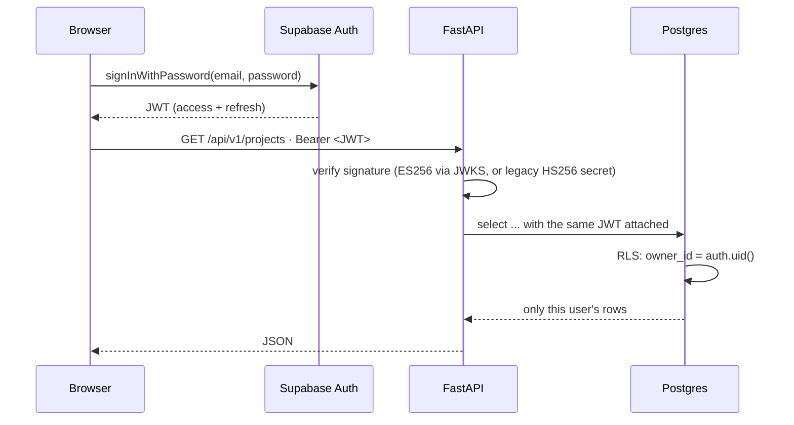

# Security

Last updated: 2026-09-06

This is a Final Year Project, not a production deployment. What follows is an
honest account of the model as built, including what is missing.

---

## 1. Authentication

**The backend never sees a password.** The browser talks to Supabase Auth
directly; what reaches FastAPI is a signed JWT.



Verification lives in `core/security.py`:

Supabase signs sessions one of two ways, and a project can use either:

| Scheme | Token `alg` | Verified against |
| --- | --- | --- |
| **JWT signing keys** (current default) | `ES256` / `RS256` | the project's public keys at `/auth/v1/.well-known/jwks.json`, fetched once and cached |
| **Legacy shared secret** | `HS256` | `SUPABASE_JWT_SECRET` |

The token header only chooses *which* key to check; each branch pins its own
allowed algorithms. Accepting HS256 alone used to reject every login on a
project that had moved to signing keys — its anon key is still HS256, so the
configuration looked correct right up until someone signed in.

- `algorithms` is pinned per branch, so a token claiming `alg: none` is rejected.
- `audience` is checked, so a token from another Supabase surface will not pass.
- Expiry is enforced by the library and surfaced as `token_expired`, which the
  client turns into a re-login rather than a generic failure.
- A token signed by a key the project does not publish is `invalid_token`; failing
  to *reach* the JWKS endpoint is `auth_unavailable`, so an outage is not
  mistaken for a bad session.
- A missing `SUPABASE_JWT_SECRET` when an HS256 token arrives is logged as a **server misconfiguration** and
  returns `auth_misconfigured`, not silently treated as "every request is
  unauthorised", which would be a confusing outage.

### Route protection

- **Frontend:** `RequireAuth` gates `/app/*` and preserves the intended
  destination, so a deep link survives the login round trip. `RedirectIfAuthenticated`
  keeps signed-in users off `/login` and `/signup`.
- **Backend:** every non-public route depends on `get_current_user`. The only
  unauthenticated endpoints are `GET /api/v1/health` and `POST /api/v1/contact`.

Frontend guards are convenience. **The backend dependency is the actual
control**: removing the guard in the browser gets you a 401, not data.

---

## 2. Authorisation

Ownership is enforced **in Postgres, not in application code.**

Every RLS policy resolves back to `projects.owner_id = auth.uid()`. The API adds
no ownership filter anywhere. This was the deciding factor in choosing the
Supabase client over an ORM: an ORM connects as one privileged role, so every
query has to remember its own `WHERE owner_id = ...`, and a single omission is a
data leak. Here a forgotten filter returns nothing rather than everything.

Full policy list: [database.md](database.md#2-row-level-security).

### The one bypass

`core/supabase.py` exposes `get_service_client()`, which uses the service-role
key and **bypasses RLS entirely**. It has exactly one caller:
`repository.get_worker_repository()`, used by the background pipeline runner, which executes after the originating request has returned and no longer holds a
JWT.

Both functions carry docstrings saying they must never be reachable from a
request handler. **This is the single most dangerous line in the codebase**; any
change near it deserves review.

---

## 3. Secrets

| Secret | Lives in | Exposure |
|---|---|---|
| `SUPABASE_SERVICE_ROLE_KEY` | `backend/.env` | **Server only. Full database access.** |
| `SUPABASE_JWT_SECRET` | `backend/.env` | Server only. Forges tokens if leaked. |
| `OPENAI_API_KEY` | `backend/.env` | Server only. Billable. |
| `APIFY_API_TOKEN` | `backend/.env` | Server only. Billable: Instagram scraping runs on Apify's infrastructure, and the token can start actor runs |
| `SUPABASE_ANON_KEY` | both `.env` files | Public by design; RLS is the protection |
| `SUPABASE_URL` | both | Public |

**Everything prefixed `VITE_` is compiled into the browser bundle** and is
readable by anyone who opens devtools. The service-role key must never appear in
`frontend/.env.local`. There is no build-time check for this. It is a rule, and
it is the one worth remembering.

`.gitignore` excludes `.env*` while explicitly keeping `!.env.example`.

**If a key is ever committed:** rotate it in the Supabase dashboard first.
Rewriting git history does not un-leak a value that has already been pushed.

---

## 4. Input validation

Validated twice, deliberately:

- **Client**: zod, via react-hook-form (`lib/validation.ts`). Fast feedback.
- **Server**: Pydantic v2 models with the same constraints. Authoritative.

A client that skips validation entirely still cannot write a bad row. Field
errors come back as `error.fields`, keyed by field name, so the form attaches
each message to its own input rather than showing one generic banner.

The database carries a third layer for the rules that must never be violated:

```sql
current_stage smallint check (current_stage between 1 and 9)
confidence    numeric(4,3) check (confidence between 0 and 1)
stage         smallint check (stage in (5, 7)), hitl_reviews
```

---

## 5. What the pipeline guarantees

The two human checkpoints are a **security property**, not a UX preference. They are the mechanism preventing unreviewed AI output from becoming a
deliverable:

- The runner returns at stages 5 and 7 and cannot be resumed except by a
  `POST` carrying a human decision.
- `gap_service.submit_review` refuses while any gap is `pending`.
- `strategy_service.submit_review` refuses a rejection with no notes.
- Every decision writes a `hitl_reviews` row: reviewer, decision, notes,
  affected ids, timestamp.

Covered by `backend/tests/test_hitl_checkpoints.py`.

---

## 6. Error handling and information disclosure

One envelope for every failure, and unhandled exceptions never leak internals:

```python
logger.exception("Unhandled error on %s (request_id=%s)", request.url.path, request_id)
return JSONResponse(status_code=500, content=_envelope(
    "internal_error",
    "Something went wrong on our side. The error has been logged.",
    request_id=request_id,
))
```

The detail goes to the log; the client gets a request id it can quote.

**Login failures do not say which field was wrong**. Supabase does not
distinguish, and neither do we, because doing so would confirm which email
addresses have accounts.

**Password reset always reports success**, whether or not the address exists,
for the same reason.

---

## 7. Known gaps

Ordered by what would matter first if this were deployed.

| # | Gap | Impact | Notes |
|---|---|---|---|
| 1 | **No rate limiting anywhere** | Contact form and auth endpoints can be hammered; a pipeline run is expensive to trigger repeatedly | slowapi, or Supabase Edge rate limits |
| 2 | **No CSRF protection on the contact form** | It is unauthenticated and writes a row | Low impact (no privileged action), but a captcha or token belongs here |
| 3 | **SSRF is blocked for the website scraper; DNS rebinding is not** | The website scraper fetches URLs a user typed, so this stopped being hypothetical when it went live. Each URL is resolved and refused if any address it answers with is private, loopback, link-local, reserved or multicast, before the request and again after a redirect (`app/scrapers/website/safety.py`). A host that resolves public at check time and private at connect time would still get through | Closing the rebinding case means pinning the connection to the address that was checked. Instagram is unaffected: the fetching happens on Apify, and only instagram.com profile links are accepted |
| 4 | **No output encoding review for agent text** | Model output is rendered as text, not HTML, so React escapes it, but a future markdown renderer would need sanitising | React's default escaping is what protects this today |
| 5 | **No audit log for non-HITL actions** | Deletes and integration toggles are unrecorded | `hitl_reviews` covers the decisions that matter most |
| 6 | **`contact_submissions` has no read path** | Deliberate: no admin UI, so a read policy would let any user harvest addresses | Service role only |
| 7 | **Session storage is `localStorage`** | XSS could exfiltrate a token | Supabase default; httpOnly cookies need a server-side auth flow |
| 8 | **No dependency scanning in CI** | Vulnerable transitive deps go unnoticed | `npm audit`, `pip-audit`, or Dependabot |
| 9 | **Demo mode accepts any credentials** | Intentional, but must never ship with `DEMO_MODE=true` | `/api/v1/health` reports it, and the login page says so |
| 10 | **Background tasks have no ownership re-check** | The runner acts under the service role using a `user_id` captured at request time | The id comes from a verified JWT, so it is trustworthy, but it is a trust boundary worth naming |

### Before any real deployment

- [ ] `DEMO_MODE=false` on both halves; confirm via `/api/v1/health`
- [ ] Fresh keys generated for the deployment; none reused from development
- [ ] SSRF guard confirmed to cover every scraper that fetches a user's URL (gap 3)
- [ ] Rate limiting on auth and contact (gap 1)
- [ ] RLS confirmed enabled on **every** table in the dashboard
- [ ] `CORS_ORIGINS` restricted to the real frontend origin
- [ ] HTTPS enforced end to end
